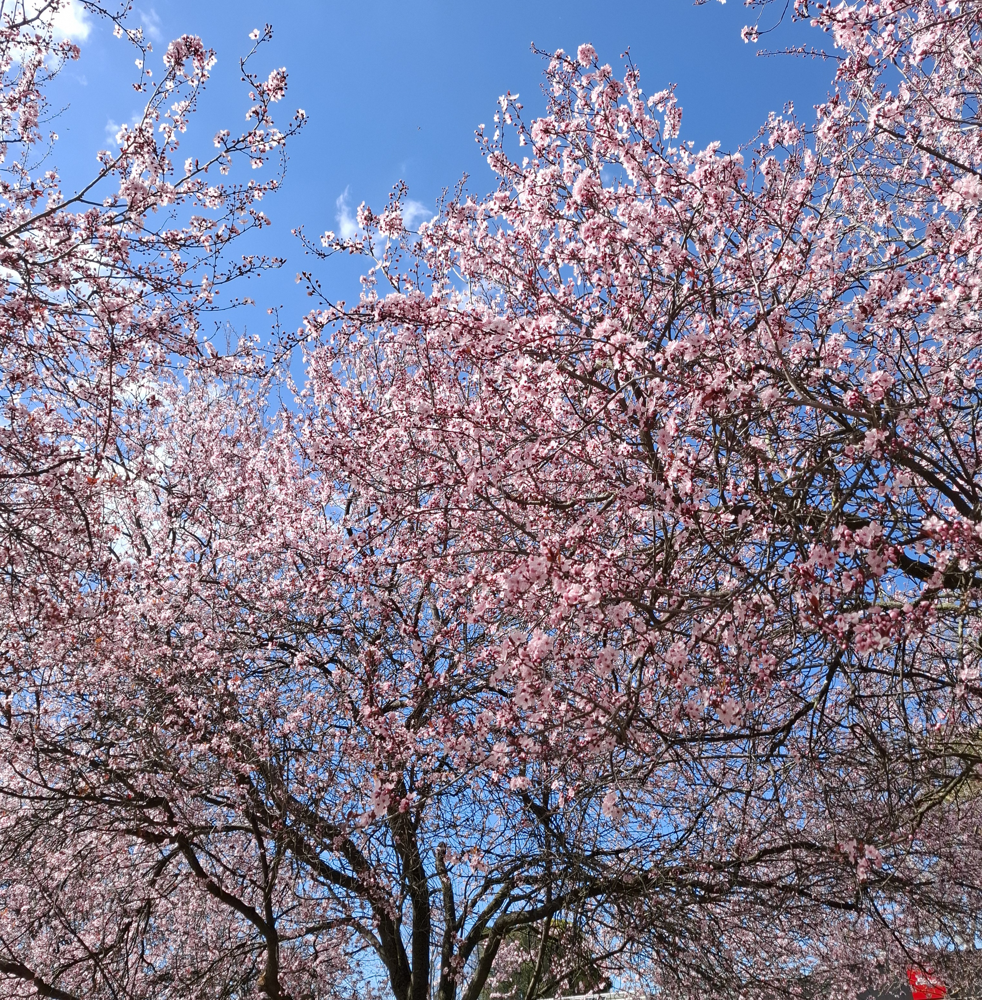

## Introduction

 
Hello!

My name is Sarah. I am 23 years old, originally from Espoo, and I now live in Helsinki. 
I study linguistics at the University of Helsinki, and this is my 3rd year. 
I hope to continue my studies in the Linguistic Diversity and Digital Humanities master’s programme. 
I enjoy going to the gym and playing video games. 

## Find me on

[LinkedIn](https://fi.linkedin.com/mouse-mousekewitz), [GitHub](https://github.com/sarahk-2304/sarahk-2304.github.io.git)

## Contact

My email address is sarah.kepot@helsinki.fi. 

## Courses I've Taken

[Yleisen kielitieteen ja fonetiikan johdantokurssi (KIK-401)](https://studies.helsinki.fi/kurssit/opintojakso/otm-9baa4a29-34d7-4594-94b9-4157be80766e), fall 2024  
[KIK-404 Korpuslingvistiikka ja tilastolliset menetelmät](https://studies.helsinki.fi/kurssit/opintojakso/otm-2b5ce352-08bb-42ee-92d5-f8e3795b042d/KIK-404), spring 2025  
[Morfologia ja syntaksi (KIK-LG102)](https://studies.helsinki.fi/kurssit/opintojakso/otm-dd991013-1c45-4477-acd5-7ad63c093fd3), spring 2025  

[KIK-405: Johdatus kieliteknologiaan](https://studies.helsinki.fi/kurssit/opintojakso/otm-a23f7021-6404-47b8-825f-9804eb649f49/KIK-405), fall 2025  
[KIK-LG101 Fonetiikka ja fonologia](https://studies.helsinki.fi/kurssit/opintojakso/otm-9ce6da69-0a37-4e64-bb54-00f3ad3546a1/KIK-LG104), fall 2025  
[Korean alkeiskurssi 1 (KK-KOR001)](https://studies.helsinki.fi/kurssit/opintojakso/otm-7b9f75d2-294e-4990-a76c-f86f95b9d53f), fall 2025  
[Saksan alkeiskurssi 1 (KK-SAK002)](https://studies.helsinki.fi/kurssit/opintojakso/otm-5888f7e0-71c8-4417-a001-db97c526f5de), fall 2025  
[Academic and Professional Communication in English 1 & 2 (CEFR B2) (KK-ENKAIKKI)](https://studies.helsinki.fi/courses/course-unit/otm-88dafb40-3215-40ba-9d5e-671002b4d2c9), fall 2025  
[Puheaineistojen litterointi (KIK-408)](https://studies.helsinki.fi/kurssit/opintojakso/otm-028b2ca5-5b5b-48ed-b3b7-90db9469485c), spring 2026  
[KIK-419: Data Analysis for the Complete Beginner](https://studies.helsinki.fi/courses/course-unit/otm-b78d3756-489b-4040-b2fe-78133837e528), spring 2026  
[KIK-417: Johdatus digitaalisiin ihmistieteisiin](https://studies.helsinki.fi/kurssit/toteutus/hy-opt-cur-2627-29f38c27-237a-49a7-8240-0a2966a584a1), spring 2026  
[Semantiikka ja pragmatiikka (KIK-LG103)](https://studies.helsinki.fi/kurssit/opintojakso/otm-91801cb0-1ff4-4804-8aac-b5f496abb040), spring 2026  

[BSCS1001: Introduction to Programming](https://studies.helsinki.fi/kurssit/opintojakso/otm-d2bcb952-2c48-4420-9901-069d822d253e/BSCS1001), fall 2026  
[ENG-502 Tekstin käsittely Pythonilla](https://studies.helsinki.fi/kurssit/toteutus/otm-ab07d3c3-ce29-4902-85cf-9a1aa9c62f78), fall 2026  
[Command Line Tools for Linguists (KIK-LG221)](https://studies.helsinki.fi/courses/course-unit/otm-92ee484e-456b-409f-a397-d9d2b6e40a2f), fall 2026  

## Projects

[cmdline-course](https://github.com/sarahk-2304/cmdline-course.git)

**Description:**  
The purpose of this project was to learn how to use git with GitHub. 
I learned to use GitHub, clone a repository, revert to a previous commit version, add files to my local repository, commit changes, and push the changes to my global repository on GitHub

## Misc. 

[Gotta Love Cheese](https://en.wikipedia.org/wiki/Cheese) 
